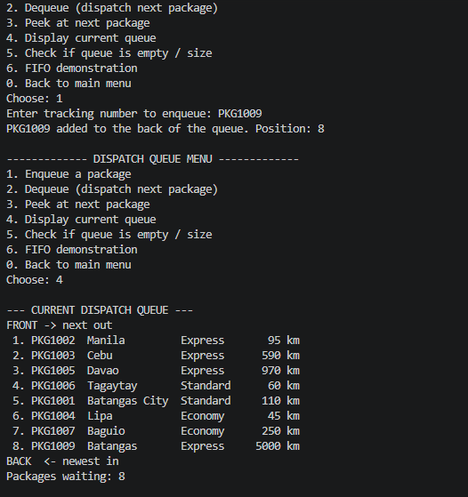
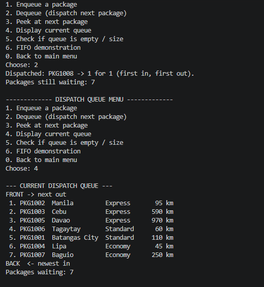

# DSA-Java-Sorting-Queue-Capstone
A console-based Java application that helps a courier hub record packages, organize them with **Merge Sort** and **Insertion Sort**, and dispatch them in **FIFO** order using a **Queue**.

The project is written **procedurally (no OOP)**: only `main`, static methods, primitives, arrays, multiple `ArrayList`s, and Java's built-in `Queue`.

| | |
|---|---|
| **Author** | _Yuan Miguel M. Lacerna_ |
| **Section** | _IT2A_ |
| **Source file** | `Phoenix_Courier_Service.java` |

---

## Table of Contents

1. [Project Overview](#1-project-overview)
2. [Features](#2-features)
3. [How to Run](#3-how-to-run)
4. [Main Menu Guide](#4-main-menu-guide)
5. [Data Design (Parallel ArrayLists)](#5-data-design-parallel-arraylists)
6. [Sorting Algorithms](#6-sorting-algorithms)
7. [Queue (FIFO) Implementation](#7-queue-fifo-implementation)
8. [Input Validation and Messages](#8-input-validation-and-messages)
9. [Sample Walkthrough with Screenshots](#9-sample-walkthrough-with-screenshots)
10. [Procedural Programming Compliance](#10-procedural-programming-compliance)
11. [Project Structure](#11-project-structure)
12. [Limitations](#12-limitations)

---

## 1. Project Overview

A courier hub receives packages with different priorities, weights, and destinations. Staff must keep track of them, decide which ones go out first, and dispatch them in an orderly way.

This program supports that workflow:

1. **Record** packages (add, display, search, update, remove).
2. **Sort** them by priority, distance, weight, destination, or tracking number.
3. **Optimize** the dispatch order (Express first, then shortest distance) and load the packages into a queue.
4. **Dispatch** packages from the queue in First-In, First-Out order.
5. **Report** on current stock and past transactions.

---

## 2. Features

- Main menu with clear numbered options
- Add, display, search, update, and remove package records
- Two manually implemented sorting algorithms: **Merge Sort** and **Insertion Sort**
- Choice of algorithm, sort field, and order (ascending/descending), with an **auto-select** option
- Records shown **before and after** sorting, plus a comparison counter
- **Route Optimizer** that combines sorting and the queue in one step
- Dispatch queue with **enqueue, dequeue, peek, display, empty check**, and a FIFO demonstration
- Summary report and transaction history
- Sample data loader for quick testing
- Input validation and messages for empty lists, empty queues, missing records, and failed operations
- Clean exit option

---

## 3. How to Run

### Requirements

- **Java Development Kit (JDK) 8 or newer**
- A terminal or command prompt

Check your installation:

```bash
java -version
javac -version
```

### Steps

1. Place `Phoenix_Courier_Service.java` in a folder.
2. Open a terminal in that folder.
3. Compile:

   ```bash
   javac Phoenix_Courier_Service.java
   ```

4. Run:

   ```bash
   java Phoenix_Courier_Service
   ```

5. Use the menu by typing a number and pressing **Enter**. Choose `0` to exit.

> **Tip:** On first run, choose **option 10 (Load sample data)** to fill the system with 7 test packages.

You can also run it from an IDE (IntelliJ IDEA, Eclipse, NetBeans, VS Code): open the file and run the `main` method of `CourierHub`.

---

## 4. Main Menu Guide

| Option | Description |
|:---:|---|
| **1** | **Add package**: enter receiver, destination, type, weight, priority, and distance. A tracking number (`PKG1001`, `PKG1002`, ...) is generated automatically. |
| **2** | **Display all packages** in a table. |
| **3** | **Search** by tracking number, receiver (partial), destination (partial), or status. |
| **4** | **Update** a package's receiver, destination, type, weight, priority, or distance. |
| **5** | **Remove** a package (with confirmation). It is also removed from the dispatch queue if queued. |
| **6** | **Sort packages**: choose the algorithm, field, and order; shows before and after. |
| **7** | **Route optimizer**: sorts by priority then distance and loads Pending packages into the queue. |
| **8** | **Dispatch queue menu**: enqueue, dequeue, peek, display, empty check, FIFO demo. |
| **9** | **Reports & history**: summary report or transaction history. |
| **10** | **Load sample data** (7 packages). |
| **11** | **About the sorting algorithms** (purpose and suitability). |
| **0** | **Exit** the program. |

### Dispatch Queue Menu (Option 8)

| Option | Description |
|:---:|---|
| **1** | **Enqueue** a Pending package to the back of the queue. |
| **2** | **Dequeue**: dispatch the package at the front and mark it *Dispatched*. |
| **3** | **Peek** at the next package without removing it. |
| **4** | **Display** the current queue (front to back). |
| **5** | **Check** whether the queue is empty and show its size. |
| **6** | **FIFO demonstration** using a separate demo queue. |
| **0** | Back to the main menu. |

### Package Fields

| Field | Values |
|---|---|
| Type | Document, Parcel, Fragile, Perishable, Electronics |
| Weight | 0.1 to 1000 kg |
| Priority | 1 = Express, 2 = Standard, 3 = Economy |
| Distance | 1 to 5000 km |
| Status | Pending, In Queue, Dispatched |

---

## 5. Data Design (Parallel ArrayLists)

Records are stored in **eight parallel `ArrayList`s**. The value at index `i` in every list belongs to the **same package**.

| ArrayList | Data type | Meaning |
|---|---|---|
| `trackingNos` | `String` | Unique tracking number (e.g., `PKG1001`) |
| `receivers` | `String` | Receiver name |
| `destinations` | `String` | Destination city |
| `packageTypes` | `String` | Package type |
| `weights` | `Double` | Weight in kg |
| `priorities` | `Integer` | 1 = Express, 2 = Standard, 3 = Economy |
| `distances` | `Integer` | Distance in km |
| `statuses` | `String` | Pending / In Queue / Dispatched |

Other structures:

| Structure | Type | Purpose |
|---|---|---|
| `dispatchQueue` | `Queue<String>` (`LinkedList`) | Holds tracking numbers waiting for dispatch |
| `history` | `ArrayList<String>` | Transaction log |

### Keeping indexes consistent

- **Adding:** `addRecord()` adds one value to every list.
- **Removing:** `removePackage()` removes index `i` from every list.
- **Sorting:** the sorts rearrange an `int[]` of record **indexes**. Then `applyOrder()` rewrites all eight lists using that order, so every record stays intact.

---

## 6. Sorting Algorithms

Both algorithms are **implemented manually** (no `Collections.sort` or `Arrays.sort`) and are **stable**: records with equal keys keep their original order.

### Merge Sort

- **How it works:** splits the list into halves, sorts each half recursively, then merges the sorted halves.
- **Time complexity:** O(n log n) in the best, average, and worst cases.
- **Why it suits this application:** a hub can handle a large number of packages, and Merge Sort stays fast on big lists. Because it is stable, the Route Optimizer can sort by **distance first and then by priority**, so packages with the same priority stay ordered by shortest distance.

### Insertion Sort

- **How it works:** takes each record and inserts it into its correct place among the records already sorted.
- **Time complexity:** O(n²) worst case, close to O(n) on small or nearly sorted lists.
- **Why it suits this application:** it is simple and has low overhead, which works well for small batches (such as one rider's parcels) or an already sorted list with a few new packages added.

### Auto-select

Sort option **3** picks **Insertion Sort for 10 or fewer records** and **Merge Sort for larger lists**.

### Sort fields

Priority, Distance, Weight, Destination (alphabetical), and Tracking number, each in ascending or descending order.

---

## 7. Queue (FIFO) Implementation

```java
static Queue<String> dispatchQueue = new LinkedList<>();
```

| Operation | Java method | Behavior in the application |
|---|---|---|
| Enqueue | `add()` | Adds a Pending package to the back; status becomes *In Queue* |
| Dequeue | `poll()` | Removes the front package; status becomes *Dispatched* |
| Peek | `peek()` | Shows the front package without removing it |
| Display | `for` loop over the queue | Lists all queued packages from front to back |
| Is empty | `isEmpty()` | Reports whether any packages are waiting |

**FIFO principle:** the first package queued is the first one dispatched. Queue menu option 6 demonstrates this: Parcel A, B, C go in and come out in the order A, B, C.

### Integration with sorting

The **Route Optimizer (option 7)**:

1. Displays all records (before).
2. Merge Sorts by **distance** (ascending).
3. Merge Sorts by **priority** (ascending). Stability keeps the distance order inside each priority.
4. Displays all records (after).
5. Enqueues every **Pending** package in that order.

Using the 7 sample packages, the resulting dispatch order is:

| Queue position | Tracking | Destination | Priority | Distance |
|:---:|---|---|---|---:|
| 1 | PKG1002 | Manila | Express | 95 km |
| 2 | PKG1003 | Cebu | Express | 590 km |
| 3 | PKG1005 | Davao | Express | 970 km |
| 4 | PKG1006 | Tagaytay | Standard | 60 km |
| 5 | PKG1001 | Batangas City | Standard | 110 km |
| 6 | PKG1004 | Lipa | Economy | 45 km |
| 7 | PKG1007 | Baguio | Economy | 250 km |

---

## 8. Input Validation and Messages

| Situation | Behavior |
|---|---|
| Invalid menu choice (letters, blanks, out of range) | Error message and the prompt repeats |
| Empty text fields (name, destination) | Rejected; asks again |
| Weight, distance, or priority outside the allowed range | Rejected; asks again |
| Display, search, update, or remove with no records | "The list is empty" style message |
| Tracking number not found | "Package not found" message |
| Sorting with fewer than 2 records | Message explaining at least 2 are needed |
| Dequeue or peek on an empty queue | "Queue is empty" message |
| Enqueue a package that is not Pending | Message showing its current status |
| Route optimizer with no Pending packages | "No Pending packages to queue" message |
| Remove or exit prompts | Confirmation before removing a package |

---

## 9. Sample Walkthrough with Screenshots

> All screenshots are stored in the `screenshots/` folder and were taken from the submitted `Phoenix_Courier_Service.java`.

### 9.1 Main Menu


### 9.2 Add Package (with validation)


### 9.3 Display All Packages


### 9.4 Merge Sort (before and after)


### 9.5 Insertion Sort (before and after)


### 9.6 Route Optimizer

.png)

### 9.7 Queue Operations

**Enqueue**



**Display queue**


**Dequeue (FIFO)**



**FIFO demonstration**


### 9.8 Invalid Input Handling


---

## 10. Procedural Programming Compliance

| Requirement | How it is met |
|---|---|
| No custom classes for entities or logic | The only class is `CourierHub`, the container for `main`; there are no objects for packages, customers, or transactions |
| No inheritance, polymorphism, encapsulation, or abstraction | None used |
| Sorting and queue not in custom classes | `mergeSort`, `merge`, and `insertionSort` are static methods; the queue is Java's built-in `Queue` |
| Records stored in ArrayLists | Eight parallel `ArrayList`s with consistent indexes |
| Allowed constructs only | Static methods, primitives, arrays, ArrayLists, loops, conditionals, `Scanner`, `Queue` |

---

## 11. Project Structure

```
DSA-Java-Sorting-Queue-Capstone/
├── src/
    └──Phoenix_Courier_Service.java
├── README.md
└── screenshots/
    ├── 01-Adding Package.png
    ├── 02-Current Queue.png
    ├── ...
    └── 12-Sorting 2(Insertion Sort)..png
```

---

## 12. Limitations

- Data is stored **in memory only**; it is cleared when the program closes.
- Console interface only (no GUI).
- Tracking numbers restart at `PKG1001` each run.
